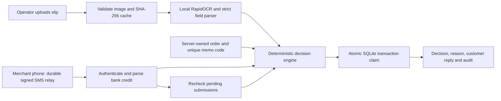

# ClearPay

**Evidence-led bank payment verification for business operators.**

ClearPay reads a payment slip locally, compares it with the order and authenticated bank SMS evidence, and returns **APPROVED**, **REJECTED**, or **NEEDS VERIFICATION**, with an internal reason and a customer-safe next step.

Built for the BuildStart Software Engineering Intern challenge. AI-assisted implementation; the accompanying interview guide explains the code and trade-offs. This is a single-merchant prototype, not a bank integration or a production payment processor.

## Version 2: bank-record auto reconciliation

Read [Auto approval guide (Sinhala)](docs/AUTO_APPROVAL_SI.md) and [v2 validation](docs/V2_VALIDATION.md).

In **Bank inbox → Merchant setup**, configure the receiving account and select **Bank records** mode before creating new orders. Import the merchant's bank export using the empty CSV template. Exact matching receipt, credit record and order memo code trigger automatic approval. Imports are labelled operator-supplied evidence; no live bank connection is established. The BOC Flex English receipt format is now supported. Existing orders keep their original account/mode. All 79 automated tests pass; no real-world accuracy percentage is claimed.

## Quick start

Requires Python 3.12, approximately 500 MB of free space, and internet access for the first dependency installation. OCR runs on the local CPU after installation; no AI API key or Tesseract installation is required.

```powershell
# Windows, from this project folder
py -3.12 -m venv .venv
.venv\Scripts\python.exe -m pip install -r requirements-dev.txt
.venv\Scripts\python.exe -m uvicorn app.main:app --host 127.0.0.1 --port 8000
```

```bash
# macOS / Linux
python3.12 -m venv .venv
.venv/bin/python -m pip install -r requirements-dev.txt
.venv/bin/python -m uvicorn app.main:app --host 127.0.0.1 --port 8000
```

Open **http://127.0.0.1:8000**. Local demo password: **`demo-operator`**. Select **Load demo scenarios** once on an empty workspace. Nine labelled synthetic cases appear. Seeding never deletes existing work.

If Linux reports a missing OpenCV shared library, install `libgl1` and `libglib2.0-0`, or use the included Docker image.

```bash
docker compose up --build
```

Docker configuration is supplied but was not executed in the development environment. Native Windows Python execution was tested. The SQLite database and local gateway key are created in `data/`, excluded from source control. Stop the server with Ctrl+C. Run a second independent demo with a different `DATA_DIR` and port; do not delete a database to reset it.

## A five-minute demonstration

1. Open Ayesha / ORD-1001: see an approved transaction, matched bank evidence, order code and audit trail.
2. Open Nimal / ORD-1002: amount is wrong, so fulfilment stays blocked.
3. Open Kavindi / ORD-1003: different pixels but the same claimed transaction, so reuse is rejected.
4. Open Ravindu / ORD-1004: bank amount conflicts with the slip; human verification is required.
5. Open Tharushi / ORD-1005: unclear image; customer is asked for a complete clearer slip.
6. Open Isuru / ORD-1006: no bank evidence. Select **Prepare matching demo SMS**, then **Receive SMS & recheck pending**. It becomes approved.
7. Open Sara / ORD-1009: matching amount and reference are still insufficient without an order code in the independent bank evidence.

Seeded scenarios simulate extracted fields and are visibly labelled as such. They test the rules and UI, not OCR accuracy. Real upload runs the OCR engine; see below.

## Exercise actual image OCR

Create a new LKR 25,000 order under **Orders**. Copy its generated payment code, then run:

```bash
python scripts/make_sample.py --code PAY-YOURGENERATEDCODE --reference TXNEW001
```

Upload `samples/upload-demo.png` against that new order. The initial decision should require bank evidence. In the demo SMS dialog, paste the contents of `samples/upload-demo.sms.txt`; the pending payment is automatically rechecked. Use the actual generated code, not the literal placeholder above. The sample is explicitly a synthetic receipt and is dated when generated.

The supported prototype format uses labelled English fields: `Amount: LKR 25,000.00`, full `Account`, `Reference`, ISO-8601 `Date` with timezone, and optional `Memo: PAY-...`. Other bank layouts, masked accounts, unreadable or ambiguous fields deliberately require verification. The OCR score is not a probability of payment authenticity.

## Architecture



| File | Responsibility |
| --- | --- |
| `app/engine.py` | Pure, explainable approval/rejection/review policy |
| `app/extraction.py` | Image validation, local OCR, money and field parsing |
| `app/store.py` | SQLite schema, transactions and immutable-by-application audit entries |
| `app/main.py` | FastAPI routes, operator session, signed gateway and atomic allocation |
| `app/demo.py` | Clearly labelled synthetic cases and receipt rendering |
| `static/` | Responsive business dashboard; no frontend build step |
| `scripts/phone_bridge.py` | Android/Termux inbox adapter with persistent retry outbox |
| `tests/` | Rules, security, concurrency, API and real synthetic-image OCR tests |

## Verification policy

Approval needs all of the following: reliable required extraction, exact LKR amount in integer cents, full receiving account match, a plausible transaction time within the order window, unused transaction, an authenticated credit notification with matching reference/amount/account/time, and the **server-generated order code in that bank notification**. The slip's memo alone does not establish ownership. Bank messages without a full account, timestamp or order code stay in review; the challenge's short masked SMS example is intentionally insufficient for automatic approval.

The merchant asks customers to enter their unique order code as the transfer memo. Banks that do not echo a reliable memo in notifications cannot use this automatic attribution path. They require a different bank-specific verified attribution mechanism or human bank-statement reconciliation. The prototype never invents an order code from matching amounts.

Money uses integer minor units and decimal parsing. A five-minute tolerance handles timestamp skew. Orders accept transfers made within two days of creation. Approval happens inside `BEGIN IMMEDIATE` with unique constraints on transaction, order, payment and bank-message allocation. An exact retry with the same idempotency key returns the original result; a changed body with that key gets HTTP 409.

## Fraud and uncertainty

- SHA-256 catches byte-identical reuse and avoids repeated OCR. Transaction identity catches different images of an already accepted transfer. Missing references cannot be safely deduplicated and remain in review.
- Wrong amounts, currencies, accounts, previously claimed transactions and old payments are rejected when the extraction gate passes. If OCR is weak, request clearer evidence instead of treating a guessed field as fact.
- Slip/SMS conflicts, ambiguous bank references, future dates and absent ownership evidence require verification.
- Edited-image detection is **not** presented as reliable visual forensics. The system detects corroboration conflicts and refuses to trust appearance alone. A perfectly edited image cannot create independent bank evidence.
- Late contradictory bank evidence raises an urgent incident on an approved payment. It does not pretend already fulfilled goods can be automatically recovered.
- Internal risk reasons and related customers stay in the operator UI. The separate customer message avoids exposing fraud rules or another customer's details.

## Bank SMS transport

`POST /api/gateway/sms` accepts JSON `{event_id, sender, text}`. Sign the exact raw body:

```text
X-Timestamp: Unix seconds
X-Signature: hex(HMAC-SHA256(secret, timestamp + '.' + raw_json_bytes))
```

The server checks a five-minute transport window, the signature, a configured sender allowlist and event ID reuse. The SMS transaction time comes from the message, not transport arrival time. Retry with the same event ID; recompute the transport timestamp/signature. An identical redelivery is idempotent. A different payload using that ID is rejected. Different events sharing a reference but disagreeing on evidence force review.

Configure `SMS_SECRET` on server and bridge without committing it. A reference sender is available:

```bash
python scripts/send_sms.py --text "Credited LKR 25,000.00 to A/C 1234567890; Ref TXNEW001; Date 2026-09-29T10:00:00+05:30; Memo PAY-YOURGENERATEDCODE"
```

For an Android merchant phone, `phone_bridge.py` reads Termux:API inbox output, filters the exact bank sender, persists events locally, and delivers them over signed HTTPS with retries. Setup and trust limits are in [docs/SMS_GATEWAY.md](docs/SMS_GATEWAY.md). The bridge parser/outbox was unit tested; a physical phone and a real bank sender were **not** connected during this implementation. Demo UI SMS is a simulation and is disabled outside demo mode.

## Configuration and security

| Variable | Default / purpose |
| --- | --- |
| `DEMO_MODE` | `true`; local demo with a visible warning and synthetic simulator |
| `OPERATOR_PASSWORD` | `demo-operator` in demo; required and at least 12 characters otherwise |
| `SMS_SECRET` | Generated in local demo; required, at least 32 characters otherwise |
| `MERCHANT_ACCOUNT` | `1234567890`, the synthetic demo account |
| `BANK_SENDER` | `DEMO-BANK`; exact sender allowed by gateway |
| `DATA_DIR` | `./data`; persistent database and local key |

`.env.example` is documentation; the application does not automatically load `.env`. Set real values in the process environment or deployment platform.

For a public deployment set `DEMO_MODE=false`, replace all demo configuration, terminate HTTPS, preserve `DATA_DIR`, use a single server worker, and place upload-size/rate limits at the reverse proxy. Non-demo cookies require HTTPS. Operator sessions and login throttling are in process memory; restart requires sign-in again. Use a dedicated test workspace and synthetic data for an interview deployment. Full production hardening is intentionally outside this prototype.

Current protections include operator authentication, HttpOnly SameSite cookies, cross-origin write rejection, escaped UI text, a restrictive content-security policy, signed gateway messages, MIME-decoded image validation, six-MB and pixel limits, atomic claims, and no manual approval bypass. An operator can record notes or reject with a reason, but cannot approve by merely editing OCR text.

## Tests and debugging

```bash
python -m pytest -q
```

The suite includes an actual synthetic PNG upload through local OCR followed by a signed SMS and approval, as well as a deliberately blurred image. Other API tests replace extraction to isolate payment policy and transaction behavior. Do not confuse either with real-world bank accuracy validation. See [docs/VALIDATION.md](docs/VALIDATION.md) and [docs/DEBUGGING.md](docs/DEBUGGING.md) for measured results, observed failures and fixes.

## Cost and limitations

No paid AI API is called. Costs remain for CPU, memory, storage, device connectivity, hosting and manual review. Model initialization is reused, successful OCR is cached, and transient engine failures are retried on a new submission. Exact client retries do not repeat processing. No external model escalation is implemented: uncertain evidence goes to review.

This is one merchant, one receiving account, LKR, selected English labelled formats, and a single application process. It does not authenticate a WhatsApp customer, send WhatsApp replies, verify bank settlement, detect every image edit, handle refunds/partial instalments, or connect directly to a bank. A signed message authenticates the configured gateway, not the bank itself. Compromised phones, SIM/sender spoofing, bank reversals and memo attribution weaknesses remain risks. No real labelled bank corpus was available, so no production accuracy percentage is claimed.

At 100,000+ monthly submissions, use tenant-scoped PostgreSQL constraints, a durable queue/outbox, bounded OCR workers, private object storage with retention, shared sessions, device-specific keys and rotation, versioned bank adapters, reconciliation against statements, review SLAs, monitoring and evaluated accuracy/cost metrics. More detail is in [docs/ENGINEERING_REPORT.md](docs/ENGINEERING_REPORT.md).

## Submission materials

- Source: this complete folder; runtime data, keys and dependency folders are excluded.
- Engineering report: `docs/ENGINEERING_REPORT.md` and the accompanying PDF when packaged.
- Debugging evidence: `docs/DEBUGGING.md`.
- Demo narration: `docs/DEMO_SCRIPT.md`.
- Interview learning guide: `docs/INTERVIEW_GUIDE.md`.

The repository is not automatically published to an external GitHub account. Review the source and choose the intended repository before uploading. No public deployment or recorded video is implied by the local demo.

## Technical references

- [FastAPI file uploads](https://fastapi.tiangolo.com/tutorial/request-files/) — upload handling.
- [RapidOCR project](https://github.com/RapidAI/RapidOCR) — local OCR implementation; this prototype pins the separate `rapidocr-onnxruntime` package.
- [SQLite transactions](https://www.sqlite.org/lang_transaction.html) — immediate write transactions and allocation consistency.
- [Termux:API](https://github.com/termux/termux-api) — optional merchant-phone bridge.
